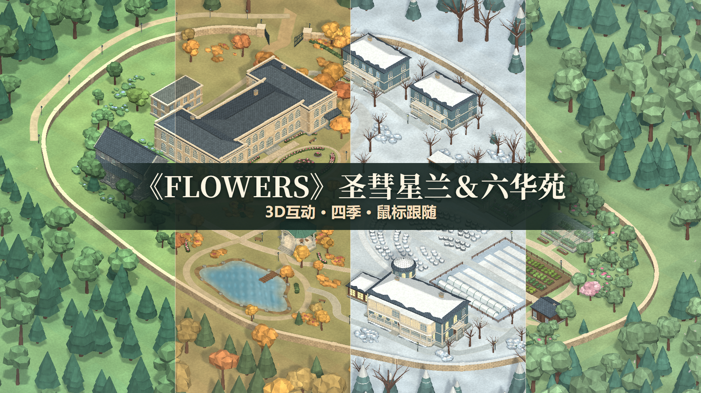

# 《FLOWERS》圣彗星兰＆六华苑｜3D互动 · 四季 · 鼠标跟随

3D 互动壁纸 · 四季切换 · 鼠标跟随 · 自由取景 · 剧情小景

一款《FLOWERS》同人互动壁纸。校园布局参考《Flowers Art Works Couleur》中的学院地图，洋馆与和馆参考现实中的六华苑。底栏可以切换四季。想在湖边多待一会儿，就到「设置 → 取景」选「东屋」。

## 安装

在 Wallpaper Engine 创意工坊搜索 **《FLOWERS》圣彗星兰＆六华苑｜3D互动 · 四季 · 鼠标跟随**，或打开[工坊条目](https://steamcommunity.com/sharedfiles/filedetails/?id=3842792968)点「订阅」。

解压后，在 Wallpaper Engine 里点「打开壁纸 → 从文件打开」，选择本目录的 `project.json`。也可以用启用了硬件加速的浏览器打开 `index.html`。

## 操作

- **取景** · 「设置 → 取景」有七个预设。开启「画面拖拽取景」后，按住「左键拖拽区」转动镜头。拖动底栏左边的六点把手可以移动整组菜单。
- **特效** · 在「设置 → 特效」调景深、对焦、粒子密度和帧率上限，也可以单独隐藏标题。地标和界面开关在底栏。
- **音乐** · 在「设置 → 音乐」选曲，可以循环播放、暂停和调音量。默认关闭配乐。
- **人物** · 在「设置 → 人物」选择剧情小景或自由摆放。小景支持聚焦、自由取景和重置。点击列表中的人名可以移动、聚焦、归位或删除人物，也能打开摇杆。按住摇杆面板顶部可移动面板。点击画面中的立绘播放语音，音量可在人物页单独调节。

| 季节 | 剧情小景 |
| --- | --- |
| 春 | 樱花道初遇、野花间的约定 |
| 夏 | 湖心泛舟、树下初闻歌声 |
| 秋 | 落叶间的野餐、林边寻星 |
| 冬 | 庭院里的雪屋、雪径结伴 |

## 制作与素材

制作 **Narc1ssusSagiran**。哔哩哔哩同名，GitHub 是 [A10nEsK](https://github.com/A10nEsK)。

校园模型和壁纸交互为同人制作。角色立绘、CG、配乐及语音来自 Innocent Grey 的《FLOWERS》系列，部分立绘参考发行版展示素材做了补全。相关素材的权利归各自权利方。本壁纸为非官方同人作品。
